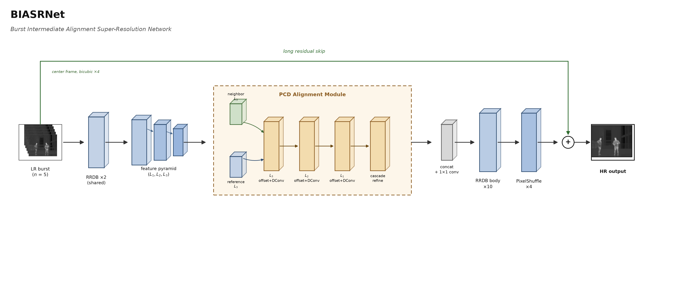
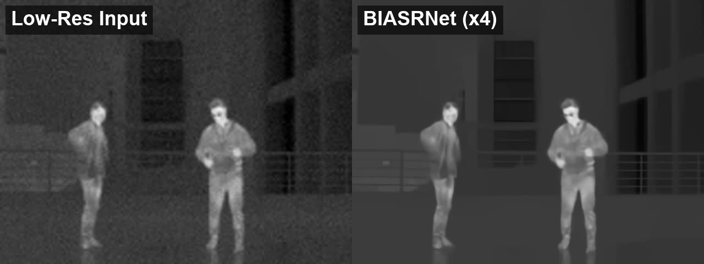

# BIASRNet

Multi-frame (burst) thermal video super-resolution, x4.

- **BIASRNet** = Burst Intermediate Alignment Super-Resolution Net.
- Pipeline: per-frame RRDB feature extraction -> EDVR-style PCD (Pyramid,
  Cascading, Deformable-conv) alignment of every neighbor frame's features
  onto the center frame's features -> channel-concat fusion -> RRDB body ->
  pixel-shuffle x4 upsample, with the center frame's bicubic upsample kept
  as a long residual skip.
- Input is expected classically pre-aligned (Farneback optical flow, see
  `align.py`); PCD then does a second, learned, feature-space re-alignment
  on top of that.
- Optimized for PSNR. See `model.py` for full architecture notes and the
  PCD reference (Wang et al., EDVR, CVPRW 2019).
- A diffusion-based perceptual-quality refinement stage built on top of a
  frozen BIASRNet checkpoint is available as a separate project,
  [BIADSRNet](https://github.com/meister1378/BiadSRNet).

### Architecture

<div align="center">
	
</div>

## Files

- `model.py` -- BIASRNet (includes the PCD alignment submodule)
- `align.py` -- classical Farneback pre-alignment for a real LR burst
- `infer.py` -- runs a trained BIASRNet on a real LR burst (no synthetic
  degradation -- this is the production inference path)

This repo ships inference code only. You'll need a trained checkpoint
(`.pth`) to run it.

## Requirements

```
torch
torchvision
opencv-python
numpy
```

## Inference

```bash
python infer.py --frames-dir /path/to/real_lr_frames \
    --ckpt ./checkpoints/biasrnet_bestPSNR.pth --out-dir ./out
```

`--frames-dir` should contain real, already-low-resolution consecutive
grayscale frames. Add `--fp16` for faster GPU inference (negligible
quality impact -- see Results below).

## Results

<div align="center">
	
</div>

Measured on an RTX 4090, 256x320 LR -> 1024x1280 HR, batch size 1, 5-frame
burst (includes the Farneback pre-alignment step):

| | Value |
|---|---|
| Params | 10.03M |
| Best val PSNR | 32.92 dB |
| fp16 vs fp32 output difference | 66.65 dB PSNR (negligible) |

## Data

Trained and evaluated on two public, permissively-licensed real thermal
video sources:
- [IRVAL](https://huggingface.co/datasets/zytlhy/IRVAL) (CC-BY-4.0)
- [issai/OpenThermalAction](https://huggingface.co/datasets/issai/OpenThermalAction) (MIT)

No other dataset is used or redistributed by this code.
