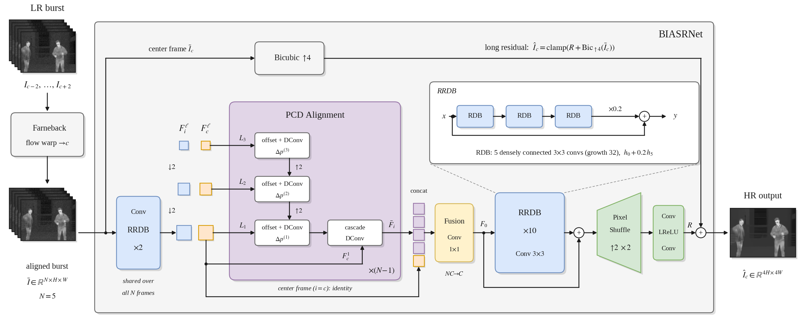
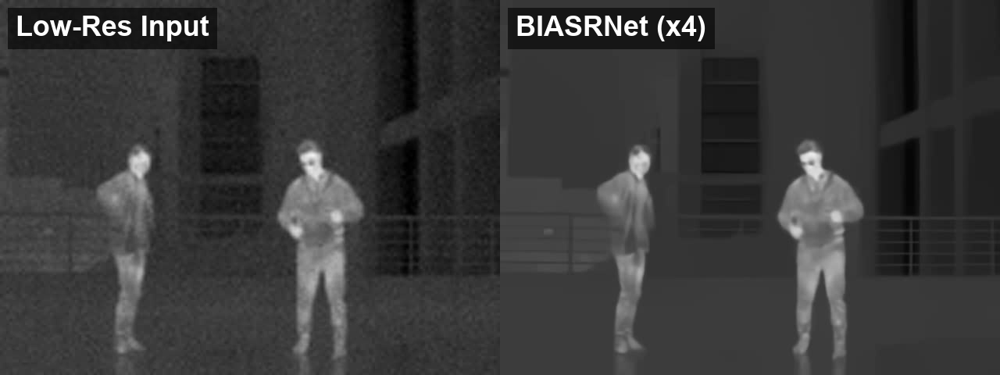
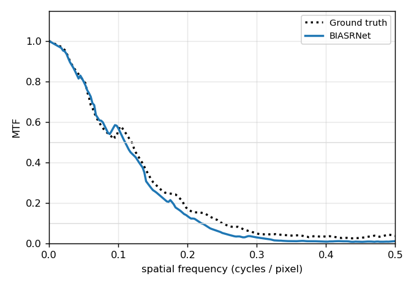

# BIASRNet

**Burst Intermediate Alignment Super-Resolution Net**: multi-frame (burst) x4 super-resolution for thermal
video.

- 10.03M parameters, 5-frame burst
- Farneback pre-alignment + learned PCD feature alignment (EDVR), RRDB body, PixelShuffle x4
- Diffusion refinement on top of it: [BIADSRNet](https://github.com/meister1378/BiadSRNet)

## Architecture

<div align="center">
	
</div>

## Structure

```
.
├── model.py                         BIASRNet
├── align.py                         Farneback pre-alignment
├── infer.py                         inference CLI
├── ckpt_crypto.py                   encrypted checkpoint loader
└── checkpoints/biasrnet_bestPSNR.pth.enc
```

## Setup

```bash
pip install torch torchvision opencv-python numpy cryptography
```

## Checkpoints

The checkpoint is encrypted. Set the key (available from the author) before running:

```bash
export CKPT_KEY=<key>
```

## Inference

```bash
python infer.py --frames-dir /path/to/lr_frames \
    --ckpt ./checkpoints/biasrnet_bestPSNR.pth.enc --out-dir ./out [--fp16]
```

`--frames-dir`: consecutive low-resolution grayscale frames.

## Results

<div align="center">
	
</div>

| | Value |
|---|---|
| Params | 10.03M |
| Val PSNR | 32.92 dB |
| fp16 vs fp32 | 66.65 dB PSNR |

## Spatial resolution (MTF)

ISO 12233 slanted-edge measurement on 23 real edges (median): FLIR-IVSR test HR frames, synthetically
degraded to 5-frame LR bursts, restored, and compared with the original HR frame.

<div align="center">
	
</div>

| | MTF50 (cy/px) | MTF10 (cy/px) | 10-90 % edge width | MTF50 / GT |
|---|---|---|---|---|
| Ground truth | 0.090 | 0.248 | 6.2 px | 1.00 |
| BIASRNet | 0.092 | 0.219 | 6.1 px | 1.02 |

The output restores the resolution of the original frame.

## License

All rights reserved.

## Data

- [IRVAL](https://huggingface.co/datasets/zytlhy/IRVAL) (CC-BY-4.0)
- [OpenThermalAction](https://huggingface.co/datasets/issai/OpenThermalAction) (MIT)
